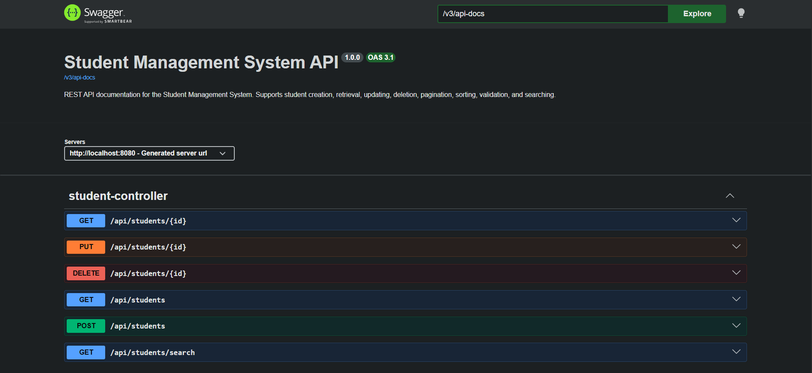
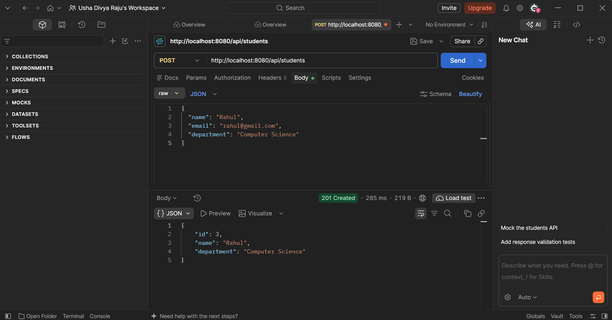
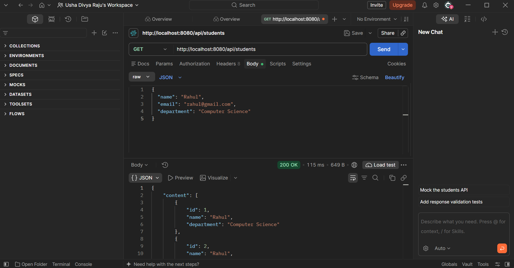

# Student Management System

A RESTful Student Management System built using Java, Spring Boot, Spring Data JPA, and MySQL. This application provides APIs to create, retrieve, update, delete, search, paginate, and sort student records.

## Technologies Used

- **Language:** Java
- **Framework:** Spring Boot
- **Database:** MySQL
- **ORM:** Spring Data JPA / Hibernate
- **Build Tool:** Maven
- **API Documentation:** Swagger / OpenAPI
- **Testing:** JUnit 5, Mockito, MockMvc, H2

## Features

- Create a student record.
- Retrieve all students.
- Retrieve a student by ID.
- Update an existing student.
- Delete a student.
- Search students by name or department.
- Pagination and sorting.
- Request validation using Jakarta Bean Validation.
- Centralized exception handling.
- API documentation using Swagger UI.
- Unit and integration tests.

## Project Architecture

The application follows a layered architecture:

```text
src/main/java/javaspringboot/Student/
│
├── config/
│   └── OpenApiConfig.java
│
├── controller/
│   └── StudentController.java
│
├── dto/
│   └── StudentRequest.java
│
├── exception/
│   └── GlobalExceptionHandler.java
│
├── model/
│   └── Student.java
│
├── repository/
│   └── StudentRepository.java
│
├── service/
│   └── StudentService.java
│
└── StudentApplication.java
```

### Layer Responsibilities

- **Controller:** Handles incoming HTTP requests and returns API responses.
- **Service:** Contains business logic.
- **Repository:** Handles database operations using Spring Data JPA.
- **Model:** Represents the Student entity.
- **DTO:** Handles and validates incoming request data.
- **Exception:** Provides centralized exception handling.
- **Config:** Contains API documentation configuration.

## REST API Endpoints

Base URL: `http://localhost:8080`

| Method | Endpoint | Description |
|---|---|---|
| POST | `/api/students` | Create a student |
| GET | `/api/students` | Retrieve students with pagination and sorting |
| GET | `/api/students/{id}` | Retrieve a student by ID |
| PUT | `/api/students/{id}` | Update a student |
| DELETE | `/api/students/{id}` | Delete a student |
| GET | `/api/students/search?name=...` | Search by name |
| GET | `/api/students/search?department=...` | Search by department |

### Pagination and Sorting

Example:

```http
GET /api/students?page=0&size=10&sortBy=id&direction=asc
```

### Search Examples

```http
GET /api/students/search?name=John
```

```http
GET /api/students/search?department=Computer Science
```

## Database Configuration

1. Install and start MySQL.
2. Create the database:

```sql
CREATE DATABASE student_management;
```

3. Configure the following environment variables:

| Variable | Example |
|---|---|
| `DB_URL` | `jdbc:mysql://localhost:3306/student_management` |
| `DB_USERNAME` | `root` |
| `DB_PASSWORD` | Your local MySQL password |

The application uses environment variables for database credentials instead of hardcoding the password in the source code.

## Run the Application

Clone the repository:

```bash
git clone https://github.com/divyaraju123/student-management-system.git
```

Navigate to the project directory:

```bash
cd student-management-system
```

Run the application on Windows:

```powershell
.\mvnw.cmd spring-boot:run
```

The application will start at:

```text
http://localhost:8080
```

## Swagger API Documentation

After starting the application, open:

```text
http://localhost:8080/swagger-ui/index.html
```

Swagger UI allows you to explore and test the available REST APIs.

## Run Tests

Execute the complete test suite on Windows:

```powershell
.\mvnw.cmd clean test
```

The project includes service-layer tests, controller tests, and repository tests.

## Future Enhancements

- Spring Security and role-based authentication.
- JWT authentication.
- Docker containerization.
- Deployment to a cloud platform.
- CI/CD pipeline integration.

## Author

**Divya Raju**

GitHub: [@divyaraju123](https://github.com/divyaraju123)

Project Repository: [Student Management System](https://github.com/divyaraju123/student-management-system)
## Screenshots

### Swagger UI – API Documentation



### Postman – Create Student API



### Postman – Retrieve All Students

